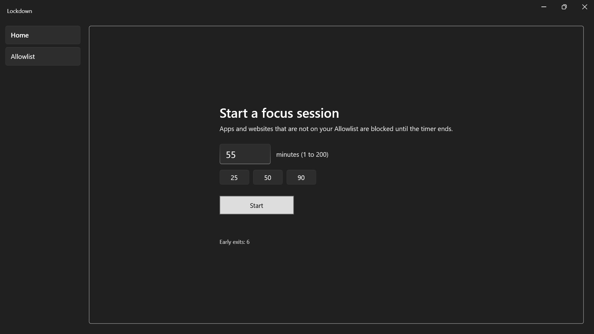
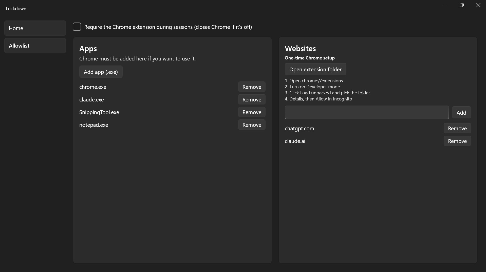

# Lockdown

A simple Windows focus tool to help you stay away from distractions and get things done.

Lockdown lets you block distracting applications and websites during focus sessions, helping you stay focused on what matters.

🌐 **Website:** https://lockdowned.pages.dev

## Features

- **Application Blocking** — Block distracting Windows applications during focus sessions.
- **Website Blocking** — Block distracting websites through the Chrome extension.
- **Custom Allowlist** — Choose which applications and websites are allowed during a session.
- **Focus Sessions** — Start a session with your restrictions in place.
- **Emergency Exit** — A controlled way to end a session early if needed.

## Installation

1. Download and install Lockdown.
2. Set up the Chrome extension for website blocking.
3. Configure your allowlist.
4. Start a focus session.

For detailed installation instructions, see [INSTALLATION.md](INSTALLATION.md).

## Screenshots

### Main Dashboard

### Allowlist

---

Made to help you focus.
